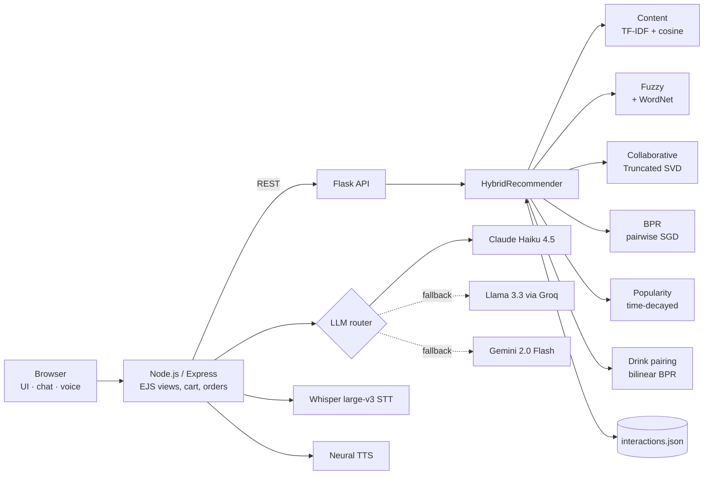

# Restaurant Recommender & AI Concierge

A hybrid recommendation engine for restaurant menus, paired with a multilingual voice/chat concierge grounded in the menu. Built end-to-end: data cleaning, five recommendation models plus an ensemble, offline evaluation, a Flask inference API, and a Node.js web app with LLM and speech integrations.


## Highlights

- **Six ranking strategies behind one API:** TF-IDF content similarity, fuzzy matching with WordNet query expansion, SVD matrix factorisation, Bayesian Personalized Ranking (BPR), time-decayed popularity, and a weighted hybrid that redistributes weight when a model lacks data.
- **Learned food → drink pairing:** a bilinear compatibility model trained with BPR on co-occurrence pairs over TF-IDF + SVD item embeddings, with co-occurrence gating to suppress noisy pairings.
- **Cold start handled:** seed taste profiles are generated from the menu itself (sweet/savory foods, coffee/tea/refreshing drinks), so collaborative models work from the first request on any menu.
- **Online learning loop:** views, likes and orders are logged through `/api/track` and the models retrain via `/api/retrain`.
- **Menu-grounded AI concierge:** chat and voice ordering in 18 languages. The LLM gets the live menu as context and can add items to the cart via structured `[ADD_TO_CART: …]` tags. Provider fallback chain: **Claude Haiku 4.5 → Llama 3.3 70B / 3.1 8B (Groq) → Gemini 2.0 Flash**.
- **Speech:** Whisper large-v3 (Groq) transcription with Gemini fallback; neural text-to-speech with pre-generation to cut reply latency.

## Offline evaluation

Leave-one-out ranking evaluation (`evaluation/offline_eval.py`): for each user, one liked item is held out and every model ranks the full menu (221 items).

| Model | HR@5 | HR@10 | NDCG@10 |
|---|---|---|---|
| Random | 0.022 | 0.022 | 0.009 |
| Popularity (time-decayed) | 0.457 | 0.457 | 0.457 |
| Content (TF-IDF user profile) | 0.457 | 0.609 | 0.449 |
| Collaborative (SVD) | 0.630 | 0.739 | 0.583 |
| BPR | 0.717 | 0.761 | 0.708 |
| SVD + BPR blend (production personalised feed) | 0.783 | 0.804 | 0.740 |
| **Hybrid (SVD + BPR + content + popularity)** | **0.804** | **0.826** | **0.769** |

> **Caveat:** most of the interaction log is bootstrapped from synthetic taste archetypes (46 users, ~1k interactions), so these numbers compare strategies against each other rather than estimate live accuracy. Re-run the script as real interactions accumulate.

## Architecture



The Express server starts the Flask API automatically on a free port (or uses `FLASK_API` if set), so a single `npm start` runs the whole stack.

## How the hybrid score works

Each engine's scores are min-max normalised and combined:

| Engine | Signal | Default weight |
|---|---|---|
| Content-based | TF-IDF over name, category and description; query expanded with WordNet synonyms | 0.45 |
| Fuzzy | Levenshtein similarity on item names | 0.20 |
| Collaborative | Truncated SVD on the user × item implicit-feedback matrix | 0.15 |
| BPR | Pairwise ranking loss, SGD on user/item embeddings | 0.10 |
| Popularity | Interaction-weighted (view < click < like < order), 5%/day decay | 0.10 |

When the collaborative models are untrained for a user, their weight shifts to the content model instead of returning empty results.

## Quickstart

```bash
git clone https://github.com/utkuemec/restaurant-recommender.git
cd restaurant-recommender

python3 -m venv venv && source venv/bin/activate
pip install -r requirements.txt
npm install

cp .env.example .env      # optional: add LLM keys to enable the concierge
npm start                 # http://localhost:3001
```

The recommender works without any API keys; the concierge activates for whichever provider keys are present (`npm run verify-keys` checks them).

```bash
python evaluation/offline_eval.py   # reproduce the evaluation table
```

## API (Flask)

| Method | Endpoint | Purpose |
|---|---|---|
| POST | `/api/recommend` | Food and drink recommendations for a free-text query (`strategy`: hybrid, content, fuzzy, collaborative, bpr, popularity) |
| GET | `/api/personalized?user_id=` | Personalised feed from SVD + BPR |
| GET | `/api/similar?item=` | Item-to-item similar dishes |
| GET | `/api/popular` | Trending items |
| GET | `/api/chefs-picks` | Top picks per category |
| POST | `/api/track` | Log a view / like / order / rating |
| POST | `/api/retrain` | Retrain collaborative models on logged interactions |
| GET | `/api/stats` | Model status and interaction counts |

## Project structure

```
├── recommendation_engine.py   # all models + HybridRecommender
├── app.py                     # Flask API, menu cleaning
├── server.js                  # Express app, LLM router, speech endpoints
├── evaluation/offline_eval.py # leave-one-out HR@K / NDCG@K
├── public/                    # chat widget, voice concierge, cart
├── views/                     # EJS templates
├── data/, domain.yml          # Rasa NLU prototype (optional)
└── user_data/interactions.json
```

## Roadmap

- Replace synthetic seed data with logged sessions and report time-split evaluation
- Sentence-embedding retrieval (e.g. `all-MiniLM-L6-v2`) as an alternative to TF-IDF
- Tune ensemble weights on validation data instead of fixed defaults
- Containerise (Docker) and deploy a public demo
